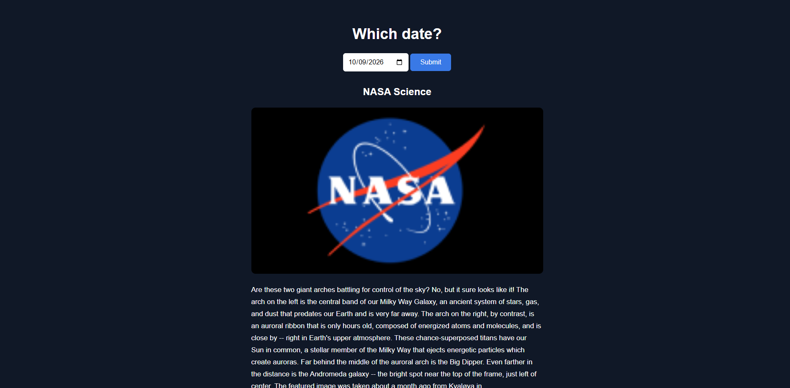

# NASA Daily Photo

An interactive web application that allows users to explore NASA's Astronomy Picture of the Day (APOD) archive by selecting a date.

Built with HTML, CSS, and JavaScript, the application integrates NASA's APOD API to retrieve astronomy images or videos, along with their titles and scientific explanations.

## Live Demo

**[Explore NASA Daily Photo](https://anwaralshohatee.github.io/nasa-daily-photo/)**

## Technologies


## Features

- Select a date using a built-in date picker
- Retrieve NASA's Astronomy Picture of the Day for the selected date
- Display astronomy images and their titles
- Retrieve NASA's explanations of astronomical events and objects
- Support image and video responses from the API
- Update page content dynamically without reloading
- Use asynchronous JavaScript and the Fetch API to retrieve external data

## Screenshot



## How It Works

1. Select a date using the date picker.
2. Click **Submit**.
3. The application sends a request to NASA's Astronomy Picture of the Day API.
4. NASA returns information about the selected date, including the title, explanation, and media URL.
5. The application displays the corresponding image or video and description.

## API Used

### NASA Astronomy Picture of the Day (APOD)

NASA's APOD API provides astronomy images, videos, titles, and explanations associated with specific dates.

**API Documentation:** https://api.nasa.gov/

The application currently uses NASA's `DEMO_KEY` for API requests, which is subject to lower request limits than a registered API key.

## Getting Started

### 1. Clone the Repository

```bash
git clone https://github.com/AnwarAlshohatee/nasa-daily-photo.git
cd nasa-daily-photo
```

### 2. Run the Application

Open `index.html` in your browser.

No additional installations or dependencies are required.

An internet connection is needed to retrieve data from NASA's API.

## Future Improvements

- Add loading indicators while retrieving data
- Improve error handling for invalid dates and API failures
- Add previous and next date navigation
- Support embedded video playback from external providers
- Improve mobile responsiveness
- Add an option to view a random astronomy picture

## Author

**Anwar Alshohatee**

[Portfolio](https://anwaralshohatee.netlify.app) | [LinkedIn](https://www.linkedin.com/in/anwaralshohatee/)
